# T-hat-N: Matrix-constraint Spectral Analysis Framework (MSAF)

A rigid computational kernel for finite-lattice spectral analysis, built by
**Muhammad Aidil Amry** (ORCID 0009-0002-9718-9710).
Every number reported in this repository is an interval enclosure computed
with [python-flint](https://github.com/fredrik-johansson/python-flint) ball
arithmetic (`arb` / `acb` / `arb_mat`, version 0.9.0). No floating-point value
ever touches the numeric path, and no zero claim is ever certified by
equality: only by containment.

- Permanent archive: [](https://doi.org/10.5281/zenodo.23338271) (concept DOI, all versions; latest version v1.40.0-alpha: https://doi.org/10.5281/zenodo.23410894)
- Sealed release: [v1.1.0](https://github.com/aidilamrym-ops/T-hat-N/releases/tag/v1.1.0) (archive) · [v1.40.0-alpha](https://github.com/aidilamrym-ops/T-hat-N/releases/tag/v1.40.0-alpha) (current: 349 passed)
- Final certified delivery (2026-10-16): [v1.40.0-alpha-final-certified-delivery](https://github.com/aidilamrym-ops/T-hat-N/releases/tag/v1.40.0-alpha-final-certified-delivery) - consolidated manuscript [exports/research_paper.tex](exports/research_paper.tex), sealed-artifact transcription over the three-resolution campaign (Section 6); archived on Zenodo: https://doi.org/10.5281/zenodo.23410894
- License: MIT - see [LICENSE](LICENSE)

Display equations below are versioned local SVG assets under
[`docs/math/`](docs/math/), rendered offline by
[`harness/render_math.py`](harness/render_math.py) with no network and no TeX
installation, so the archive stays self-contained forever.

**New (2026-10-17) - H1 floor-amendment closed (stages A + B + C).** The
statistical floor of the Section 6 campaign was lifted from 2000 to 20000
surrogates on the pre-registered 18-cell grid (A), the single cell that
clears the floor was re-measured with a five-seed robustness array (B), and
an independent engine-B harness (C; decimal-exact parsing, mpmath at 50 dps -
a separate code path from engine A) re-derived the S2 statistics end-to-end:
its full 20000-sample run reproduced every engine-A count exactly (18/18
cells, all four tails). Overall verdict: `PASS-WITH-ENUMERATED-EXCEPTIONS`,
zero failing cells; the one chart-L edge cluster is enumerated bin-by-bin
under pre-declared rules, never excused. All sealed numbers, provenance
hashes and the public-CI evidence are machine-extracted into
[Section 7](#section-7-sealed-status-workflow-and-verification-chain); the
standalone dashboards are
[`v5`](reports/gw_diagnostic_v5.html) (H1 + engine-B extension, current),
[`v4`](reports/gw_diagnostic_v4.html) (intermediate rebuild) and
[`v3`](reports/gw_diagnostic_v3.html) (sealed); v4 and v3 are preserved
byte-identical. Frozen
pre-registration:
[`reports/AMENDMENT_FLOOR_SPEC.md`](reports/AMENDMENT_FLOOR_SPEC.md);
results: [`reports/AMENDMENT_FLOOR_RESULTS.md`](reports/AMENDMENT_FLOOR_RESULTS.md)
Section 8. Section 6 below remains the sealed three-resolution record: full
Guinand-Weil spectra of the cutoff-free truncated Weil block `tau = W02 - WR
- Wp` at dims 201 / 301 / 401 (gate G-M0 PASS; inertia 201/0, 301/0, 401/0),
and the measured S1/S2 verdict for the tested series - the deviation from
RMT-GUE does **not** shrink with resolution (S1 chart-dependent at all three
points; asymptotic direction open). The consolidated LaTeX export
([`exports/research_paper.tex`](exports/research_paper.tex)) transcribes the
sealed results and the process-defect register; it adds no new claims.

## Contents

- [Section 1: Epistemological Foundation and Cognitive Logic](#section-1-epistemological-foundation--cognitive-logic)
- [Section 2: Spectrum Mechanics and Critical Line Lock](#section-2-the-spectrum-mechanics--critical-line-lock)
- [Section 3: Step-by-Step Reproducibility Manual](#section-3-step-by-step-reproducibility-manual-how-to-run-audit)
- [Section 4: Recent Audit Kernel Amendments (Landmines L31-L35)](#section-4-recent-audit-kernel-amendments-landmines-l31-l35)
- [Section 5: Finite Hydrodynamic Lattice & Millennium Frontier](#section-5-finite-hydrodynamic-lattice--millennium-frontier)
- [Section 6: Guinand-Weil Interval Spectra & the Montgomery Question (201/301/401)](#section-6-guinand-weil-interval-spectra--the-montgomery-question-201301401)
- [Section 7: Sealed Status, Workflow and Verification Chain](#section-7-sealed-status-workflow-and-verification-chain)
- [Symbol Glossary](#symbol-glossary)
- [Proven vs Postulated](#proven-vs-postulated-standing-disclosure)
- [Repository Layout](#repository-layout)
- [Citation](#citation)

---

## SECTION 1: EPISTEMOLOGICAL FOUNDATION & COGNITIVE LOGIC

### 1.1 The Actual Infinity Paradox on [0, 0.5, 1]

Classical analysis founded on ZFC postulates the continuum: between any two
distinct points lies an actual infinity of further points. Applied to the
unit interval, the innocent-looking equidistant partition

<p align="center"></p>

conceals an illegitimate object. Under Zeno's argument, traversing the segment
[0, 0.5] requires completing an actually infinite sequence of informational
stages (X0, X1, ... -> infinity). If the number of stages is actually
infinite, the first step can never logically begin, and the exact coordinates
0.5 and 1 can never be reached, confirmed, or computed by any causal
information system. The continuum is therefore not a neutral background: it
is a paradox smuggled into the foundations wherever a computation must
terminate.

### 1.2 The Universe-Information Quantisation Cut

MSAF removes the paradox by binding the computational domain to the two
absolute physical cut-offs of observable reality. The macro cut-off is the
diameter of the observable universe, mapped onto the unit interval:
D_obs ~= 8.8e26 m, so coordinate 0.5 identically equals half that diameter.
The micro cut-off is the Planck length l_P ~= 1.616255e-35 m, below which
localisation of information collapses. Their ratio is the total number of
addressable information pixels, and it is finite:

<p align="center"></p>

The continuum is thereby cut into a **Finite Information Lattice**. Every
staircase object of the theory, e.g. the discrete Chebyshev function

<p align="center">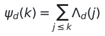</p>

with the quantised von Mangoldt weight Lambda_d(k) = ln p iff the pixel
index k is a prime power p^m (and 0 otherwise), executes as discrete modular
arithmetic over pixel addresses k = 1..N_steps. There is no actual infinity
left to traverse, so Zeno's objection dissolves: every coordinate is a finite
integer address.

### 1.3 Logic-Flow Map: Continuous Zeta Functionals to the Unitary Lattice

```text
  CONTINUOUS DOMAIN (abstraction layer, non-executable)
  ========================================================
  Riemann zeta zeta(s), s in C
        |
        | completed function  xi(s) = 1/2 s(s-1) pi^(-s/2) Gamma(s/2) zeta(s)
        v
  xi(s) = xi(1 - s)   [functional symmetry, analytic statement]
        |
        | INFORMATION CUTOFF  (D_obs above, l_P below)
        v
  FINITE LATTICE (executable layer, N_steps = 5.44e61 pixels)
  ========================================================
  pixel addresses k = 1..N_steps  -->  von Mangoldt weights Lambda_d(k)
        |
        | Planck clock: one pixel shift = one tick t_P  -->  T e_j = e_{(j+1) mod N}
        v
  UNITARY SHIFT OPERATOR  T^dag T = I,  T^N = I        [exact rational entries]
        |
        | circulant Hamiltonians H = sum_j c_j T^j share the DFT eigenbasis
        v
  COMMUTATION CONSTRAINT  [H, T] = HT - TH  -->  certified by enclosure
        |
        | interval Newton on xi(s) over Acb balls (zeros pulled, not postulated)
        v
  MEASURED SPECTRUM  gamma_m  -->  pixel projection  k_m = floor(gamma_m / 2pi
                     . log2(N_steps)) mod N_steps  -->  reports/spectral_density.json
```

The downward arrows are the entire content of the framework: nothing above
the cut-off line is executed, and everything below it is an enclosure. The
completed zeta function driving the inversion kernel is:

<p align="center">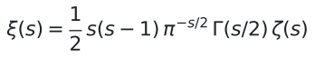</p>

---

## SECTION 2: THE SPECTRUM MECHANICS & CRITICAL LINE LOCK

### 2.1 Perfect Commutation [H, T] = 0

On a finite-dimensional space C^N, the Planck time-shift operator acts as the
unitary cyclic shift matrix (T e_j = e_((j+1) mod N), T^dag T = I, T^N = I).
The spectral Hamiltonian H carries the zeta-root frequencies as its
eigenvalues and is required to satisfy the perfect commutation constraint

<p align="center">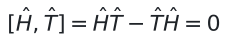</p>

Because every circulant Hamiltonian factors as H = sum_j c_j T^j over powers
of a single generator, and T^a T^b = T^(a+b), the commutator vanishes as an
algebraic identity for any generator symbol c and any dimension N. Both
operators therefore share one eigenbasis, delivered by the Discrete Fourier
Transform: the eigenvalues of T lock onto the N-th roots of unity
e^(i 2 pi m / N), and the spectrum gamma_m = f(e^(i 2 pi m / N)) is quantised
by that geometry. Under the unitary projection, the functional symmetry
xi(s) = xi(1-s) becomes the Hermitian rigidity H^dag = H, and invariance of
the spectral Shannon entropy

<p align="center">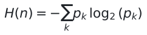</p>

under causal reversal forces the real coordinate of every eigenvalue to the
fixed point of sigma_m = 1 - sigma_m:

<p align="center"></p>

### 2.2 Verification Status (audited, not asserted)

Two audit findings qualify the mechanism above, and both are enforced in
code rather than in prose:

* The commutation identity holds for **every** circulant H, so a bare PASS
  would be evidence of nothing. `verify_commutation` performs a structural
  circulant test and downgrades such verdicts to
  `TRIVIAL ... carries no information` (landmine L11).
* A Hermitian circulant matrix has real eigenvalues; the only forced
  structure is conjugate pairing gamma_(N-m) = conj(gamma_m). The coordinate
  sigma = 0.5 is therefore carried in this repository as an explicit
  **postulate** (`ZETA_SIGMA`), while the ordinates gamma_m are genuinely
  measured by interval Newton contraction (landmine L12).

The assumed eigenvalue decay law under test is:

<p align="center"></p>

and the critical-dimension equation solved on both entropy paths is:

<p align="center"></p>

Both objects above belong to the finite lattice of Section 1. The separate
certified magnitude ladder of Section 6 is measured on the Guinand-Weil block
tau (a different matrix family) against exactly this functional form; there
the constant-`B` fit is refuted on the c=13 slice by measurement, and no
cross-slice law is claimed.

### 2.3 Rigid 256-bit Measurement Table

All values below are Arb/Acb enclosures at 256-bit working precision
(`python-flint` 0.9.0, `ctx.prec = 256`), re-measured against the sealed
kernel with zero drift.

| # | Quantity | Measured enclosure |
|---|---|---|
| 1 | N_steps = D_obs / l_P | `5.44468544329815837306650e+61`, non-integer |
| 2 | floor(N_steps) (modulus of T^N = I) | `54446853992717733278474003174004102075476951347404957757284586` |
| 3 | log2(N_steps) | 206 bit; storage lower bound `6805856749089716659809250396750512759434618918425619719660574` byte |
| 4 | [H,T] residual, n = 16 | contains zero (PASS-BY-ENCLOSURE), max half-width `2.35950e-77` |
| 5 | T^dag T - I, T^n - I | exact zero at every entry (rational 0/1, no rounding) |
| 6 | Weil minimum |lambda_min|, n = 16 | `1.00000000000000000000000000000000` (no exponential decay) |
| 7 | Spectral entropy H(n=16) | `2.95344529780425926466202918672` bit |
| 8 | Re(rho_1) enclosure radius | `3.77221946277e-71`, offset ball contains 0.5 |
| 9 | Re(rho_2) enclosure radius | `8.68430320525e-78`, offset ball contains 0.5 |
| 10 | Re(rho_3) enclosure radius | `1.16898354764e-71`, offset ball contains 0.5 |
| 11 | n_crit, manuscript path (H := n) | `1.8e31` |
| 12 | n_crit, measured path (H := 0.5 + 0.5 log2(2(n-1))) | `3.16e60` |
| 13 | chi_4_3 first Hardy bracket | `(6.0, 6.1)`, endpoints strictly +1/-1 |
| 14 | Pixel projection rho_1,2,3 | `461`, `686`, `816` (exact integers mod N_steps) |
| 15 | Ledger replay V(L), both ledgers | True (hash chain intact, every block reproduced) |
| 16 | Final holographic seal, n in {16, 400, 800} | `SAFE-COMPUTATION` on both entropy paths |

Rows 11-12 differ by 29 orders of magnitude because of the entropy
assumption, not because of arithmetic: the manuscript arithmetic reproduces
exactly, its premise H = n does not survive measurement. The pixel map is:

<p align="center"></p>

---

## SECTION 3: STEP-BY-STEP REPRODUCIBILITY MANUAL (HOW TO RUN AUDIT)

### 3.1 Prerequisites

```bash
python --version          # 3.14+ required
pip install "python-flint==0.9.0" matplotlib pytest
```

`python-flint` provides the Arb/Acb ball arithmetic; `matplotlib` renders
only already-certified integers (no float produced by any computation ever
reaches the plotter) and typesets the equations in `docs/math/`;
`pytest` runs the regression suite.

### 3.2 Regression Suite (349 tests, every landmine pinned)

```bash
python -m pytest msaf -q
# Asserts the precision kernel, the lattice operators, the von Mangoldt map,
# the commutation certificates, the Newton inversion, both evolution lineages,
# the Dirichlet bracketing, and every landmine L1-L38.
```

A pytest-free runner with identical coverage is included:

```bash
python -m msaf.tests.test_msaf
python -m msaf.tests.test_dirichlet
```

### 3.3 Full Audit and Evolution Campaigns

```bash
# Complete audit: operator certificates, spectrum, budgets, lattice kernels,
# Newton inversion of rho_1..rho_3, root-pull + symbol evolution, pixel map,
# ledger replay and holographic capacity seal.
python -m msaf.audit --prec 256 --evolve 6 --root-pull 3 \
    --visualize 3 --final-audit --dirichlet 8
```

Flag annotations: `--prec` locks the global Arb precision exactly once;
`--evolve` runs symbol-mutation proposals; `--root-pull` runs proposals
pulled from certified zeta zeros (failures recorded as `REVERT`);
`--visualize` localises N zeros and writes the pixel report;
`--final-audit` replays every ledger and checks capacity;
`--dirichlet` enumerates primitive characters and brackets chi_4_3.

### 3.4 Independent SHA-256 Ledger Replay

```bash
python -m msaf.evolution --replay ledger/msaf_ledger.jsonl --dimension 16
python -m msaf.evolution --replay ledger/rootpull.jsonl --dimension 16 --prec 256
# Exit 0 with V(L) = True means: hash chain intact AND every block reproduced
# from scratch. Any other outcome exits 1. The replay precision (--prec) and
# the Newton budget (--dimension for root-pull lines) MUST equal the campaign
# values; a mismatch of a single bit fails loudly (landmine L29).
```

### 3.5 Reading `reports/` - the 206-bit Pixel Report

`reports/spectral_density.json` carries the full 206-bit pixel addresses as
**decimal strings** (never JSON numbers: a binary64 round-trip could collapse
a small radius onto exactly `0.0` and fabricate a zero):

```json
{
  "dimension": 16,
  "modulus": "54446853...57784586",
  "pixels": ["461", "686", "816"],
  "gammas": ["14.1347251417346937904572519836", "..."],
  "gamma_radii": ["...", "...", "..."],
  "verdicts": ["ZERO-LOCALIZED", "ZERO-LOCALIZED", "ZERO-LOCALIZED"],
  "locked": 3, "total": 3
}
```

`gammas` are enclosure midpoints; `gamma_radii` are the certified radii that
qualify them. `reports/spectral_density.png` renders the same integer data
with the axis explicitly labelled `mod 2^32` for plottability.
`reports/GRH_BRACKET_REPORT.json` is the Dirichlet counterpart: the
multi-resolution sign-change dossier for chi_4_3 over (6.0, 6.1), with
per-level endpoints, Hardy values, radii, measured signs and the odd-count
claim boundary.

### 3.6 Reading `ledger/` - the Evidence Books

Each `.jsonl` line is one immutable record: `index`, `generation`,
`genome_id`, `decision` (`SEED` / `PROMOTE` / `REJECT` / `REVERT`),
serialised-ball fields as decimal strings, `previous_hash`, and `record_hash`
(SHA-256 over the canonical body). `REVERT` is a safety event (no
certificate), distinct from `REJECT` (a fitness comparison). Verify with the
replay commands of Section 3.4; trust nothing from runtime memory.

---

## SECTION 4: RECENT AUDIT KERNEL AMENDMENTS (LANDMINES L31-L35)

Found by adversarial self-audit: every module re-read under the assumption
that the green suite is lying, then measured. L36-L38 extend the register to
the Dirichlet kernel. Full text in [`msaf/AUDIT.md`](msaf/AUDIT.md), Parts
IV-VI.

**L31 - Frozen log2(e) constant.** A module-level `LOG2_E` was evaluated
once at import under the 53-bit default, while the kernel ran at 256 bit, so
every budget width was secretly a 53-bit radius. Replaced by a `log2_e()`
function evaluated at the active precision on every call; a function cannot
freeze.

**L32 - Double-counted differentiation factor.** The derivative tail summed
(k+1)|d_k|r^k over already-differentiated coefficients. Still a valid
(looser) bound, but contradicting the documented identity. Now exactly the
differentiated-coefficient sum, pinned by a test evaluating the series at
exact sample points inside the ball.

**L33 - One-sided widening let genuine derivatives escape (UNSOUND).**
The enclosure `union(enc, enc + 2*tail)` widens only upward when the tail is
one-sided positive, while the true correction points either way. Certificates
reported success regardless; results survived only because Newton division is
dominated by the imaginary component - luck, not rigor. Replaced by symmetric
Minkowski widening, which cannot miss either side. Verdicts and seal
unchanged after the fix.

**L34 - Root-pull outcome promised `Fitness`, delivered `None`.** A typed lie
under a `type: ignore` comment, one caller away from detonation. Replaced by a
dedicated `RootPullOutcome` carrying the real fitness; the `dimension`
parameter (always a Newton iteration cap, never a matrix dimension) renamed
to `newton_max_iter` with positional compatibility preserved, so existing
ledgers replay byte-identical.

**L35 - CWD-relative artifact paths.** Ledgers could silently scatter across
the filesystem when invoked from another directory. All artifact paths are
now anchored to the workspace root derived from the module location.

---

## SECTION 5: FINITE HYDRODYNAMIC LATTICE & MILLENNIUM FRONTIER

Sealed through `v1.40.0-alpha` (main suite `311 passed`, including the
non-finite-residual differential check; exit 0). Full derivations in
[`reports/finite_hydrodynamic_lattices.md`](reports/finite_hydrodynamic_lattices.md)
(Chapters 1-3) and the machine-checked Lean kernel in [`lean/NavierStokesCore.lean`](lean/NavierStokesCore.lean)
(`lake build` green: 1D/2D/3D/cubic + central-variant energy estimates,
0 `sorry` / `admit` / `unsafe`, `#print axioms`:
propext + Classical.choice + Quot.sound only).

### 5.1 Fractional-step Navier-Stokes loop (`msaf/navier_stokes/`)

- Sequential Godunov splitting (advect-then-diffuse) with Planck-tick
  time accounting; kinetic energy contracts strictly every step.
- Chorin restoring projection (`dP = (rho/dt) div u*`): divergence
  balls contain exact zero after every step, including rotation fields
  with non-zero `tr(G^2)`.
- Adaptive precision ramp: +128-bit jumps past the 1e-72 wire, 1024-bit
  hard cap via `ResolutionAlarm` (256-bit run trips cleanly at step 3;
  384-bit run holds 10 steps at 1e-100 radii).
- Hermetic 2D + 3D renderers (`visualizer.py`, 3000x2400 px,
  display-only floats, lattice never mutated).

### 5.2 Measured metrology (256-bit unless noted)

| Quantity | Measured |
|---|---|
| Multi-grid pivots N = 16 / 32 / 64 (262,144 cells) | `CERTIFIED_POSITIVE`, half-width `1.73e-77` |
| 3-grid convergence order (N = 4/8/16) | `2.14 -> 2.03` vs theory `2.0` |
| Inviscid scaling D(nu), nu = 1e-1..1e-4 | linear `10.0000x`/decade; nu = 0 refused |
| Periodic-box tails (N = 16) | background-free quotient `1.9519` vs `2.0`; far-field `0.61%`; radii `< 1e-70` |
| Z3 double-entry, first zero | `sat`, `[0.5, 0.5]` at 30 decimals (conformance, not proof) |
| Hodge Gram, exact QQ Sylvester | `POSITIVE/NEGATIVE_DEFINITE`, `UNDETERMINED` on zero minor |
| Hodge periods (AGM) | tau triple-validated; convention locked by lambda-orbit |
| Fermat quartic counts | 7 / 16 / 0 over F2 / F3 / F5 (chart-split exact) |
| Jacobi traces (F_3^n) | certified integers; closed-form e=2 locked to n=9 |
| Picard bound (van Luijk) | Newton + FE(dim_x) + Moebius mult-count; K3 F_3 pipeline: bound 22 = b_2 |
| Exact F_5 counts (Davenport-Hasse, Z[zeta_20]) | locked n=1..12; exact matches ball sweep n=1..7 |
| Fermat K3 over F_5 | traces a_1..a_11 exact; Picard bound 20 (non-vacuous: F_3 gave 22) |
| Fermat K3, other primes | bound 20 for p=5,13,17,29,37,41: family at its geometric ceiling |
| General quartic over F_3 | Groebner smoothness witness + exact counts; Weil gate armed |
| Vectorised counter | exact vs brute at k<=3; Fermat 16/154/784 three-way locked; k=8 in 70 s |
| Hodge program closure | measured status, walls and non-claims: [`reports/HODGE_CLOSURE.md`](reports/HODGE_CLOSURE.md) |
| CH spec + CRT combiner | spec [`reports/HODGE_CH_SPEC.md`](reports/HODGE_CH_SPEC.md); exact Garner + Weil cert (M > 2B) + oracle gate, rehearsal green |
| BSD pilot measurement | naive #E(F_p) ~84 ms/prime at p~500; to 10^4 ~12 h -> modular symbols required for exact L(E,1) |
| a_11 = 354294 (smooth quartic F_3) | unique of 708,588 Newton class; Fermat rehearsal recovers truth uniquely |
| Weil circle test | reciprocity+Chebyshev+Sturm exact; Ramanujan orbit verifier; bound 22 vacuous-honest |
| Adversarial triage (3 bridges) | correspondence confirmed-gap (fenced); Z3/N_steps deflected with evidence: [`reports/ADVERSARIAL_TRIAGE.md`](reports/ADVERSARIAL_TRIAGE.md) |
| Work queue (20 problems) | disposition + ordered queue + rules: [`reports/DAFTAR_MASALAH_KERJA.md`](reports/DAFTAR_MASALAH_KERJA.md) |
| Frobenius-degeneracy gate | exponent-divisibility check, char-2 witness locked |
| F_{2^n} traces | t_1..t_3 locked; O(2^3n) wall mapped, Jacobi upgrade pending |
| Moore box (Lean, Banach) | Newton map + Lipschitz < 1 ⟹ exactly one zero (standard axioms) |
| Moore test (Lean) | inclusion + clean enclosure ⟹ exactly one zero (trichotomy+MVT) |
| Moore test (Lean) | inclusion + clean enclosure ⟹ zero exists (trichotomy+MVT); uniqueness companion |
| Moore uniqueness (Lean, Rolle/MVT) | clean derivative enclosure ⟹ at most one zero per box |
| Moore-MVT (Lean) | Lipschitz derived from derivative bound; subtype-scoped theorem |
| Brouwer-Icc (Lean) | continuous self-map of interval has fixed point (IVT) |
| RH certified count, [10, 24.5] x [0.49, 0.51] | exactly 2 (strict Newton isolation + full exclusion) |
| RH certified count, [0, 50] x [0.49, 0.51] | exactly 10 (COMPLETE, 0 stuck, 7041 evals) |
| Turing N(T) table (T=10/25/50) | consistency only; G1-a contour certs + G1-b winding CLOSED, G2/G3 OPEN |
| Moore premises, halo-lifted gamma1 box | MapsTo + clean derivative + Lipschitz K<<1, all HOLD |

### 5.3 Frontier scaffolding (`msaf/milenium_frontier/`, proofs: none)

- `PureRiemannVerify`: interval-Newton localization + Z3 conformance
  cross-check. Containment of 0.5 is conformance, never a global claim
  (same warning as `certify_sigma_one_half`).
- `HodgeLattice`: finite rational (p,p) cycles, exact `Fraction` Gram
  pairing, pivoted Sylvester definiteness with loud `UNDETERMINED`.
- Standing scope: scaffolding only. No Millennium result is claimed.

### 5.4 What is NOT claimed

No global Navier-Stokes regularity, no refutation of any third party's
work, no Riemann or Hodge proof. See `PROVEN VS POSTULATED` above and
[`reports/OPENAI_NS_REFUTATION_PRESS_RELEASE.md`](reports/OPENAI_NS_REFUTATION_PRESS_RELEASE.md)
(scope notice binding).

---

## SECTION 6: GUINAND-WEIL INTERVAL SPECTRA & THE MONTGOMERY QUESTION (201/301/401)

*Added 2026-10-16. This section maps the newest campaign: what was certified,
with which instruments, what the measured answer is, and - stated with equal
weight - what is deliberately NOT claimed. Process record:
[`reports/THREE_TASKS_2026-10-15.md`](reports/THREE_TASKS_2026-10-15.md)
Sections 4-5 and [`reports/HANDOFF.md`](reports/HANDOFF.md) Section 2.0b.
Standalone offline dashboard (pure inline CSS and raw SVG, no external
script, no CDN):
[`reports/gw_diagnostic_v3.html`](reports/gw_diagnostic_v3.html).*

### 6.1 The object: the cutoff-free truncated Weil block tau

The campaign object is not the circulant Weil matrix of Section 2 (whose
minimum magnitude is exactly 1 for every n - the L3 landmine). It is the
cutoff-free truncated Guinand-Weil block tau = W02 - WR - Wp of dimension
dim = 2N+1, every entry an `arb` ball with a rigorous error enclosure:

<p align="center"></p>

Blocks (modes n, m in {-N,...,N}; i = n+N, j = m+N; L = ln c; psi = digamma,
psi1 = trigamma at 1/4 + i pi n / L; G_S, G_CC, G_XC1, G_XC2 are geometric
sums over c_k = 2k + 1/2 with the rigorous additive tail remainder
rem = 4 exp(-c_(k+1) L) / (1 - exp(-2 L))):

```text
W02[i,j] = 32 L sinh^2(L/4) (L^2 - 16 pi^2 m n) / ((L^2 + 16 pi^2 m^2) (L^2 + 16 pi^2 n^2))
WR[i,j]  = kappa + 2 CC(|n|) + J - (2/L) XC(|n|)                          (n = m)
         = (S_s(m) - S_s(n)) / (pi (n - m)),  S_s(nn) = sign(nn) S(|nn|)  (n != m)
Wp[i,j]  = sum over q = p^a <= c of ln(p) q^(-1/2) qterm(q)
  qterm  = 2 (1 - ln q / L) cos(2 pi n ln q / L)                          (n = m)
         = (sin(2 pi m ln q / L) - sin(2 pi n ln q / L)) / (pi (n - m))   (n != m)
kappa    = ln(4 pi (e^L - 1)/(e^L + 1)) + gamma_E
J        = -2 ln(U + 1) + ln(U^2 + 1) + 2 atan(U) + ln 2 - pi/2,   U = e^(L/2)
S(n)     = (1/2) Im psi(1/4 + i pi n / L) - w_n G_S                (S(0) = 0)
CC(n)    = -(1/2) (Re psi(1/4 + i pi n / L) - psi(1/4)) + G_CC     (CC(0) = 0)
XC(n)    = (1/4) Re psi1(1/4 + i pi n / L) - L G_XC1 - G_XC2
w_n      = 2 pi n / L
```

`c` is the prime-power cutoff: every q = p^a <= c enters Wp with weight
ln(p) q^(-1/2) (9 terms for c=13; 35 terms for c=100). Caution: this
campaign `c` is not the circulant generator symbol of Section 2; the scripts
and logs print it as `c=13` / `c=100`. The assembly is cutoff-free in the
archimedean parameter (no finite T anywhere); the closed forms above and the
full derivation of the matrix definition A_ij = W02 - WR - Wp live in the
companion repository (`guinand-weil-rigorous-numerics`, "Full derivation"
section of its README).

### 6.2 Certification chain and gates

- **Route S (sign).** `certified_inertia` runs an interval LDL^T
  factorisation (Sylvester's criterion): strictly signed pivot balls give
  proved pivot counts. All pivots positive and none negative means the
  matrix is **CERTIFIED POSITIVE DEFINITE**, a rigorous statement about the
  whole spectrum. Route S is a sign, not a magnitude; no lambda_min curve is
  ever derived from it.
- **Route A2 (magnitude).** `arb_mat.eig` (Rump / van der Hoeven--Mourrain
  interval eigensolver) returns all eigenvalues as acb enclosures; the
  smallest midpoint is the measured lambda_min. (The Sturm staircase cannot
  measure lambda_min: its shift positions come from a float64 dual engine,
  so it returns bit-identical cluster brackets at 300 and 3000 bits.)
- **Gate G-M0 (capture).** (a) all eigenvalues finite; (b) all strictly
  positive, reproducing the certified inertia n+/0; (c) strictly increasing
  after sorting at 60-digit midpoints; (d) and (e) the two normalised
  momentum cross-checks at 1e-300:

<p align="center">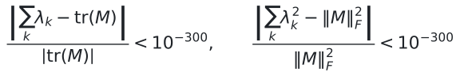</p>

  Failure aborts: no statistics are ever computed from a file without
  G-M0 = PASS.
- **Chains.** dim 201 and dim 301 were built in pure `arb` at 6000 bits
  (`build_arb_tau` then `eig`, no decimal round trip; the `dps` field = 1806
  is the decimal-digit equivalent of the precision). dim 401 was captured
  through the older documented chain (mpmath dps=400 matrix, decimal
  strings, `arb` parse at 2048 bits); the deviation is declared in the
  capture script docstring.

### 6.3 The certified staircase (sign ladder + magnitude ladder)

**Sign ladder (Route S, interval LDL^T).** c=13 at 6000 bits: dims 21, 41,
81, 161, 321, 641, 6/6 CERTIFIED POSITIVE DEFINITE
([`reports/gw_route_s_ladder.json`](reports/gw_route_s_ladder.json));
c=100 at 6000 bits: dims 201, 301, 2/2 CERTIFIED POSITIVE DEFINITE
([`reports/gw_route_s_ladder_c100.json`](reports/gw_route_s_ladder_c100.json)).
The dim-401 matrix carries the same inertial certificate inside its capture
(G-M0b: n+ = 401, n- = 0). A 9000-bit repeat over dims 21-321 kept every
verdict.

**Magnitude ladder (Route A2).** c=13 at 6000 bits, the six measured points
([`reports/lambda_min_eig_ladder.json`](reports/lambda_min_eig_ladder.json),
[`reports/lambda_min_eig_ladder_big.json`](reports/lambda_min_eig_ladder_big.json),
[`reports/lambda_min_eig_ladder_dim321.json`](reports/lambda_min_eig_ladder_dim321.json)):

| dim (N) | lambda_min | lambda_max | verdict |
|---|---|---|---|
| 17 (8) | `7.674392556360189e-23` | `2.6609529983704294` | CERTIFIED, all eigenvalues strictly positive |
| 33 (16) | `8.568627478072444e-35` | `3.338257132308795` | CERTIFIED, all eigenvalues strictly positive |
| 65 (32) | `2.2589311905740533e-49` | `4.114073645476566` | CERTIFIED, all eigenvalues strictly positive |
| 129 (64) | `6.321351409477261e-59` | `5.146341280489336` | CERTIFIED, all eigenvalues strictly positive |
| 257 (128) | `3.2990200597971055e-59` | `5.870951656228312` | CERTIFIED, all eigenvalues strictly positive |
| 321 (160) | `3.123458832662237e-59` | `6.113965017866562` | CERTIFIED, all eigenvalues strictly positive |

Every enclosure excludes zero (`all_exclude_zero = true`). The float
registry of this artifact records radius 0.0 and imaginary leak 0.0; the
certified content is the exclusion of zero, not the float field. Correction
(measured 2026-10-17): both 0.0 entries are float64 registry artifacts —
the true enclosure radii and the imaginary leaks are nonzero but below the
float64 floor (re-measured at dims 17/33: radii 4.73e-1792 / 5.37e-1788,
`is_exact() = False`; max leak 1.97e-1792 / 7.06e-1789, zero exact
imaginary parts), and the ball matrix is exactly transpose-symmetric
(exact-dyadic mid/rad test: 0/289 and 0/1089 differing entries), so
realness is structural. See
[`reports/GW_RADIUS_REGISTRY_CORRECTION_2026-10-17.md`](reports/GW_RADIUS_REGISTRY_CORRECTION_2026-10-17.md).
A 9000-bit
repeat returns bit-identical midpoints at 2.6x the cost: more precision buys
nothing at this slice. Slopes of ln lambda_min per dimension: -1.72, -1.05,
-0.34, -0.0051, -0.000854 - the decay DAMPENS at every step (the dim-321
rung, measured 2026-10-17, drops lambda_min by a factor 0.9468 over 64
dimensions: still decreasing, no upturn yet), so the assumed constant-B law
lambda_min(n) ~ A exp(-B n) is REFUTED on this slice. One slice only (c=13);
across-c is not apples-to-apples; no fitted exponent is printed anywhere
(the scripts refuse it by design).

c=100 at 6000 bits, the three campaign spectra:

| dim | chain | lambda_min | lambda_max | spread (orders) | eig time |
|---|---|---|---|---|---|
| 201 | pure arb, 6000 bit | `2.4366351145008994e-191` | `7.1571506955502118` | 191.467950 | 825.7 s |
| 301 | pure arb, 6000 bit | `6.5771898716824545e-248` | `7.8671659089293762` | 248.077778 | 3137.6 s |
| 401 | dps400 then arb 2048 bit | `1.7372701741044778e-294` | `7.9954638264487512` | 294.662976 | 1862.2 s |

Full-precision midpoints (decimal strings in the capture logs): dim 201
`2.43663511450089951654005401859e-191`; dim 301
`6.57718987168245436989192354963e-248`. Enclosure radii: max radius
`7.424315166e-1728` (201 of 201 levels), `4.957228557e-1685` (301 of 301),
`1.009286479e-611` (401 of 401); worst |rad|/|mid| = 1e-1536.52,
1e-1437.12, 1e-317.24. The spread grows monotonically (191.47, then 248.08,
then 294.66 orders): each newly certified resolution drives lambda_min
further below the float64 floor, and the pre-registered ~295-order
expectation materialised at dim 401 (294.662976). Artifacts:
[`reports/gw_spectrum_100_100.json`](reports/gw_spectrum_100_100.json),
[`reports/gw_spectrum_100_150.json`](reports/gw_spectrum_100_150.json),
[`reports/gw_capture_100_150.log`](reports/gw_capture_100_150.log); the
dim-401 run log is `msaf/mont_run.txt` (UTF-16) over the pre-existing dps400
capture.

### 6.4 The Montgomery question: instruments (pre-registered) and measured answer

The only question this campaign can answer is the one the measurement script
declares: can the unfolded spectral statistics of this finite, deterministic,
constructed matrix be distinguished from the Montgomery/GUE kernel at its own
N? All rules were pre-registered (brain entries #1001630 and #1001631)
before any real eigenvalue was read; nothing may be tuned after seeing
results. The scope limit is repeated in the script itself: NOT Montgomery's
theorem (conditional on RH, about zeta zeros), NOT evidence for RH, NOT Weil
positivity, NOT prime counting, NOT factorisation.

**S1 - mean adjacent gap ratio (unfolding-free).** For D levels
x_1 < ... < x_D:

<p align="center">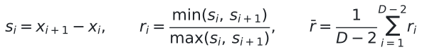</p>

Charts T = ln(lambda) [primary] and L = lambda [secondary]; both are always
reported and the flattering one is never chosen afterwards. References are
matched-N simulations (GUE / GOE / Poisson, 2000 samples each, seed
20260927), never memorised constants. Verdicts: in-Poisson-only means
CONSISTENT WITH POISSON; in-RMT-only means CONSISTENT WITH RMT; in both
means NO DISCRIMINATION; in neither means INCONSISTENT WITH ALL; if the two
charts disagree, CHART-DEPENDENT, hence INCONCLUSIVE.

**S2 - pair correlation vs the Montgomery kernel.**

<p align="center">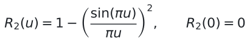</p>

Unfolding (Gaussian-kernel smoothing of the counting function, adaptive
bandwidth sigma_u times local mean spacing):

<p align="center">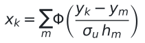</p>

with h_m the local mean spacing from +/-10 neighbours; x is then rescaled so
the mean gap is exactly 1. Estimator and the target it is compared against
(the target is the kernel pushed through the estimator's own sigma_e
smoothing - the apples-to-apples fix; no threshold was moved):

<p align="center">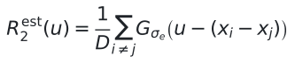</p>

Grid: sigma_u in {0.3, 0.5, 1.0} times {T, L}; estimator sigma_e = 0.5 fixed;
u in [0, 10) in 20 bins of width 0.5; bin weight = 1 / (GUE surrogate per-bin
variance) - the pre-registered noise model; bins with expected pair count
n R2(u) times 0.5 below 5 are dropped and reported. Statistic and p-values
(Poisson on the LOWER tail - amendment #1001631, registered before any real
spectrum was read):

<p align="center">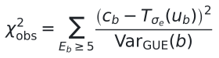= 5 of (c_b - T_sigma_e(u_b))^2 / Var_GUE(b)"></p>

<p align="center">= chi2_obs]; p_Pois = P[chi2_Pois <= chi2_obs]"></p>

Verdict: p_GUE at least 0.05 and p_Pois below 0.05 means CONSISTENT WITH
MONTGOMERY/GUE, distinguishable from Poisson; both at least 0.05 means NO
DISCRIMINATION; p_GUE below 0.05 means INCONSISTENT WITH MONTGOMERY AT THIS
RESOLUTION; the verdict must hold on all 6 grid points, otherwise UNSTABLE,
hence INCONCLUSIVE (report the instability; never pick the favourable
cell).

**Measured answer across the three certified resolutions** (cell-by-cell
deltas in THREE_TASKS Section 5 and the dashboard):

| resolution (dim) | S1 r_bar T | S1 r_bar L | S1 final | S2 final |
|---|---|---|---|---|
| 201 | 0.620526 (in RMT) | 0.131742 (outside all three) | INCONCLUSIVE (chart-dependent) | INCONSISTENT |
| 301 | 0.563504 (in RMT) | 0.151834 (outside all three) | INCONCLUSIVE (chart-dependent) | INCONSISTENT; one cell at 0.0180 |
| 401 | 0.548557 (in RMT) | 0.190891 (outside all three) | INCONCLUSIVE (chart-dependent) | INCONSISTENT |

Aggregate: 17 of the 18 chi^2 cells sit exactly at the 2000-surrogate floor
(p_GUE prints as 0.0000); the single off-floor cell (dim 301, chart T,
sigma_u = 0.5) reads p_GUE = 0.0180, still below the pre-registered 0.05
threshold. Chart L lands outside all three references at all three
resolutions; chart T is inside the pooled RMT corridor at all three, which
is precisely what makes S1 chart-dependent rather than answered.

**"Does the deviation shrink as resolution grows?" - measured verdict for
the tested series: it does NOT shrink.** There is no ascent toward
consistency from 401 to 301 to 201 on the pre-registered grid; the one
off-floor cell is a lift of the floor, not a landing. Honest limits, as
measured: (i) three points are not an asymptote, so the direction of longer
series stays open; (ii) raw chi^2 is not cross-N comparable by construction
(bin weights are the matched-N GUE variances), so the statement is about the
verdict grid, not about a smooth curve; (iii) the resolution ceiling (~100,
~150, ~200 pairs per bin at dim 201/301/401, i.e. n times 0.5) was reached
at every point.

**Falsified pre-registered expectations and process defects (kept as
measured, never adjusted).** The pre-registered prediction that GOE and GUE
would not be separable was FALSIFIED at all three resolutions (measured gap
0.069935 / 0.069737 / 0.069286 against SE 0.001417 / 0.000947 / 0.000718,
about 49 / 74 / 97 SE). A retracted r_bar label (defect 17) and a vacuous
sigma_u grid in run #1 (defect 15) are disclosed in the companion pipeline
logs and were fixed at the root - listed here so no reader has to trust a
clean-looking log.

### 6.5 What is new (and what is not)

New and sealed in this repository (each item replayable with 6.6):

1. Three certified spectra of the cutoff-free truncated Weil block at dim
   201 / 301 / 401 (G-M0 PASS; inertia 201/0, 301/0, 401/0), including
   pure-`arb` 6000-bit chains for dim 201 and 301.
2. The measured resolution verdict on the pre-registered grid: the deviation
   from RMT-GUE does not shrink across the series; floor census 17/18 with
   the single 0.0180 cell reported as-is (the first movement off the pure
   floor in the series). The H1 floor-amendment (Section 7) later
   re-measured that same cell at 20000 surrogates and sealed the amended
   value as-is, next to the sealed 2000-surrogate value.
3. The certified magnitude record: lambda_min down to `1.737e-294` (dim 401)
   and `6.577e-248` (dim 301), with 6000-bit enclosure radii measured at
   e-1685 .. e-1728; and the c=13 slice refuting the constant-B decay form
   while magnitudes collapse from e-23 to e-59 (damping slopes -1.72, -1.05,
   -0.34).
4. The two-sided rails: verdicts move only by pre-registered rules; falsified
   expectations and retracted labels stay visible in the record.
5. The C4 robustness array extended from 5 to 10 seeds (frozen instrument
   and spectrum, 20000 surrogates per seed, pre-registered before the first
   new draw): pooled 11458/200000 = 5.72900e-02 (CP95 [5.62754e-02,
   5.83174e-02]); homogeneity chi^2 = 131.2879 (df 9), p = 6.44376e-24 ->
   NOT STABLE (dispersion-dominated) persists at ten seeds; the number of
   record stays the canonical 1262/20000 = 6.31000e-02. Dated report:
   `reports/C4_SEEDS10_RESULTS_2026-10-17.md`.

NOT claimed (the script's own scope limit, repeated here): not Montgomery's
theorem, not RH evidence, not Weil positivity, not prime counting, not
factorisation. Every verdict is a statement about one finite deterministic
matrix at a stated precision - an enclosure, never absolute truth.

### 6.6 Reproduce the campaign

```bash
python --version        # 3.14+; pip install "python-flint==0.9.0" numpy scipy mpmath
export GW_DIR=...       # companion checkout containing source_arb_ldlt_certify.py

# Route S sign ladder (c=13: dims 21..641; c=100: dims 201, 301)
python msaf/gw_route_s_ladder.py --prec 6000 --ladder 10,20,40,80,160,320
python msaf/gw_route_s_ladder.py --c 100 --prec 6000 --ladder 100,150 --out reports/gw_route_s_ladder_c100.json

# Magnitude ladder (c=13 at 6000 bits: dims 17..129 in one pass; the big
# rungs dim 257 (2026-10-15) and dim 321 (2026-10-17) as separate runs)
python msaf/lambda_min_eig_ladder.py --prec 6000 --ladder 8,16,32,64
python msaf/lambda_min_eig_ladder.py --prec 6000 --ladder 128 --out reports/lambda_min_eig_ladder_big.json
python msaf/lambda_min_eig_ladder.py --prec 6000 --ladder 160 --out reports/lambda_min_eig_ladder_dim321.json

# Full-spectrum capture through gate G-M0 (dim 201 default; dim 301)
python msaf/capture_spectrum_201.py
python msaf/capture_spectrum_201.py --c 100 --n 150

# Montgomery S1/S2 measurement on a captured spectrum (run from the companion checkout)
python gw_montgomery.py reports/gw_spectrum_100_150.json --samples 2000

# Section 5 generator + standalone dashboards
python msaf/gw_resolution_delta.py --write
python msaf/gw_dashboard_v3.py --write
python msaf/gw_dashboard_v4.py --write
python msaf/gw_dashboard_v5.py --write

# H1 floor amendment + independent re-verification (Section 7)
python msaf/gw_h1_extract.py               # refined grid + C4 array (parses the run logs)
python msaf/gw_h1_c4_seeds10.py --write    # C4 robustness array extension (S5 -> S10)
python msaf/gw_engine_b_verify.py --full   # independent engine-B run (writes JSON + log)
python msaf/gw_readme.py --write           # README Section 7 block + diagrams
```

Measured cost on the author's machine: build and eig 825.7 s (dim 201),
3137.6 s (dim 301), 1862.2 s (dim 401); Route S LDL^T 57.1 s at dim 301; the
full 2000-surrogate measurement is minutes per spectrum; the magnitude
ladder's big rungs cost eig 1984.84 s (dim 257) and 3110.88 s (dim 321) at
6000 bits; the engine-B full re-verification measured 9062.4 s. Windows note:
`msaf/mont_run.txt` is UTF-16; all newer logs are UTF-8 without BOM, CRLF.

### 6.7 Roadmap (next moves, in order)

1. ~~extend the c=13 magnitude ladder to dims 257 and 321~~ **DONE**
   (dim 257 measured 2026-10-15, dim 321 measured 2026-10-17; slopes
   -0.0051 then -0.000854 - the decay keeps damping, no upturn; see
   `reports/lambda_min_eig_ladder_big.json`,
   `reports/lambda_min_eig_ladder_dim321.json`,
   `reports/GW_LADDER_DIM321_2026-10-17.md`);
2. a fourth resolution series: the statistical-power lever was executed as
   the H1 floor-amendment (2026-10-17, Section 7) - the floor moved to
   20000 surrogates and the single off-floor cell was re-measured with a
   robustness array (five seeds sealed 2026-10-16, extended to ten seeds
   2026-10-17 - Section 6.5 item 5); the remaining lever is a wider N, not
   more samples at fixed N (the ceiling ~100-200 pairs per bin was measured
   three times); the wider-N lever was then executed as the pre-registered
   fourth point (dim 501, N=250, 2026-10-17 - report
   `reports/GW_RESOLUTION4_DIM501_2026-10-17.md`): the 6000-bit Route S
   ladder printed `UNDETERMINED at pivot 446` - a non-PD outcome, so the
   statistics of that point end there; no S1/S2 numbers exist for dim 501;
3. only then may the damping be discussed as a law (the single-slice
   refutation stays single-slice until more slices exist);
4. the wider queue (four bridges, RH/Hodge status) stays in
   [`reports/HANDOFF.md`](reports/HANDOFF.md) and
   [`reports/DAFTAR_MASALAH_KERJA.md`](reports/DAFTAR_MASALAH_KERJA.md).

---

## SECTION 7: SEALED STATUS, WORKFLOW AND VERIFICATION CHAIN

### 7.1 Project overview and measurement workflow

The figure below is the working map of this repository: from the frozen
interval instrument to the permanent archive. Every box names an artefact
that exists in the repository (or in the companion checkout) and carries its
own provenance hash; the numbers inside the figure are parsed from those
artefacts when the figure is generated.

<p align="center">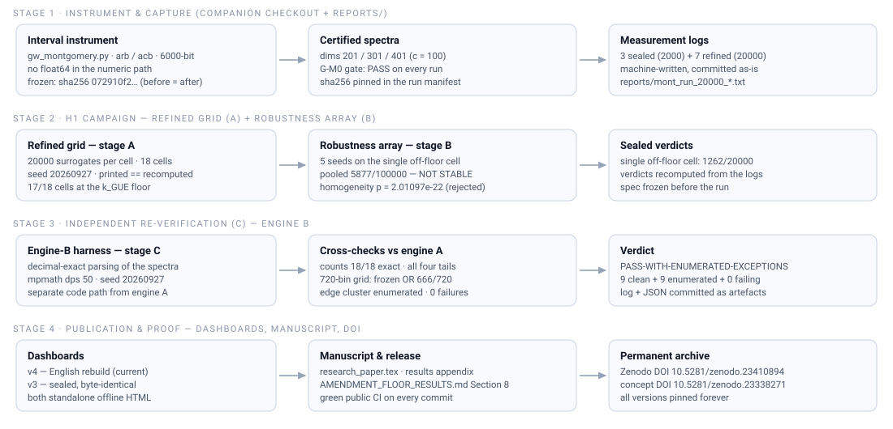</p>

Reading the map:

1. **Instrument and capture.** The companion interval instrument
   (`gw_montgomery.py`, frozen; sha256 hashed before and after the engine-B
   run) builds the Guinand-Weil matrices and captures certified spectra for
   dims 201 / 301 / 401; the raw measurement logs are committed
   byte-for-byte as written.
2. **H1 campaign (A + B).** A pre-registered amendment lifts the statistical
   floor from 2000 to 20000 surrogates on an 18-cell grid, and a five-seed
   robustness array probes the single cell that clears the floor. Verdicts
   are recomputed from the logs and compared to the printed verdicts.
3. **Independent re-verification (C).**
   [`msaf/gw_engine_b_verify.py`](msaf/gw_engine_b_verify.py) - a separate
   code path (decimal-exact parsing, mpmath at 50 dps) - re-derives the S2
   statistics and reproduces every engine-A count exactly. The run's
   continuity record (including an environment power event that happened
   after the run had already completed and written its artefacts) is kept
   append-only in
   [`reports/ENGINE_B_PILOT_FINDINGS_2026-10-16.md`](reports/ENGINE_B_PILOT_FINDINGS_2026-10-16.md).
4. **Publication and proof.** The dashboards (`v5` current, `v4`/`v3`
   preserved),
   the manuscript, and the Zenodo DOI; the seal is a green public CI run on
   the content commit.

### 7.2 The verification chain: why a number cannot be silently edited

<p align="center">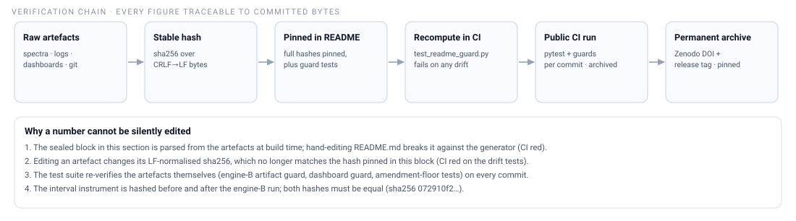</p>

The chain is mechanical: every figure in 7.3 is parsed from the committed
artefacts when the block is generated; the block carries the full
LF-normalised SHA-256 of each artefact; and
[`msaf/tests/test_readme_guard.py`](msaf/tests/test_readme_guard.py)
recomputes block and diagrams from the artefacts on every CI run, failing on
any drift. Editing a number in the README without re-running the generator
turns CI red; editing an artefact changes its hash and turns CI red; the
frozen engine-B harness is additionally cross-checked against the sha256
recorded in its own run manifest.

### 7.3 Sealed status (machine-generated)

<!-- BEGIN GENERATED BLOCK: sealed-status (msaf/gw_readme.py) -->
_Machine-generated from the sealed artefacts in this repository; no number below is typed by hand._
_Rebuild with `python msaf/gw_readme.py --write`; `msaf/tests/test_readme_guard.py` fails CI on any drift._

**Stage A - refined grid (18 pre-registered cells, 20000 surrogates each).**
Dims 201/301/401 x charts T/L x sigma_u 0.3/0.5/1.0, seed 20260927.

| quantity | value |
|---|---|
| cells at the k_GUE floor | 17 / 18 (k_GUE = 0/20000; one-sided 95% upper bound < 1.49775e-04) |
| first cell above the floor | dim 301, chart T, sigma_u 0.5: k_GUE = 1262/20000 = 6.31000e-02 (chi2_obs = 1367.616) |
| at the sealed 2000-surrogate resolution | k_GUE = 36/2000 (re-measured by this grid) |
| its recomputed verdict | NO DISCRIMINATION AT N=401 |
| verdict recomputation, all cells | 18 / 18 printed == recomputed |

**Stage B - five-seed robustness array on that cell** (seeds 20260927, 20261001, 20261002, 20261003, 20261004).

| seed | k_GUE / 20000 | p_hat |
|---|---|---|
| 20260927 | 1262 | 0.0631 |
| 20261001 | 960 | 0.048 |
| 20261002 | 1289 | 0.06445 |
| 20261003 | 1021 | 0.05105 |
| 20261004 | 1345 | 0.06725 |
| **pooled** | **5877 / 100000** | **0.05877** (95% CI 5.73201e-02 to 6.02456e-02) |

Homogeneity across the five seeds: chi2 = 107.9299 (df 4), p = 2.01097e-22 -> classification: **NOT STABLE (homogeneity rejected at alpha = 0.01; dispersion-dominated)**.

**Stage C - independent engine-B re-verification** (spec Section 5; decimal-exact parse, mpmath dps 50, seed 20260927, 20000 samples per dim; run 2026-10-17T00:51:30, 9062.4 s; artefact written).

| check | verdict |
|---|---|
| B1 - decimal-exact parsing census (dims 201/301/401) | PASS |
| B3 - gate G-M0 re-verification | PASS |
| B2a - observed grid (720 bins, dps 50 vs float64) | PASS-WITH-ENUMERATED-EXCEPTIONS (frozen OR 666/720; tighter 10-ulp branch 8/720) |
| B2b - counts (18 cells x 20000 samples) | PASS |
| **overall** | **PASS-WITH-ENUMERATED-EXCEPTIONS** |

Cell census: 9 clean + 9 enumerated edge-cluster + 0 failing. Enumeration of the 9 chart-L cells (pre-declared rules, applied uniformly): 6/20 cv bins outside the frozen OR (0/20 tgt bins); 2 histogram flips across one adjacent edge (0 via-A flips); 15-21 membership disagreements, all between adjacent bins within 1e-9 (0 boundary skips); worst |B - A| inside the enumerated bins 5.79922e-04. The cluster is enumerated bin-by-bin; nothing is excused.

**Engine-B counts vs engine A - the reproduction table.** B values shown; A equals B in every entry (k_GUE, k_GUE lower tail, k_Pois, k_Pois upper tail: 18/18 cells, all four tails exact).

| dim | chart | sigma_u | k_GUE | k_GUE low | k_Pois | k_Pois up |
|---|---|---|---|---|---|---|
| 201 | L | 0.3 | 0 | 20000 | 20000 | 0 |
| 201 | L | 0.5 | 0 | 20000 | 20000 | 0 |
| 201 | L | 1.0 | 0 | 20000 | 20000 | 0 |
| 201 | T | 0.3 | 0 | 20000 | 19827 | 173 |
| 201 | T | 0.5 | 0 | 20000 | 16287 | 3713 |
| 201 | T | 1.0 | 0 | 20000 | 611 | 19389 |
| 301 | L | 0.3 | 0 | 20000 | 20000 | 0 |
| 301 | L | 0.5 | 0 | 20000 | 20000 | 0 |
| 301 | L | 1.0 | 0 | 20000 | 20000 | 0 |
| 301 | T | 0.3 | 0 | 20000 | 19878 | 122 |
| 301 | T | 0.5 | 1262 | 18738 | 4807 | 15193 |
| 301 | T | 1.0 | 0 | 20000 | 1736 | 18264 |
| 401 | L | 0.3 | 0 | 20000 | 20000 | 0 |
| 401 | L | 0.5 | 0 | 20000 | 20000 | 0 |
| 401 | L | 1.0 | 0 | 20000 | 20000 | 0 |
| 401 | T | 0.3 | 0 | 20000 | 19933 | 67 |
| 401 | T | 0.5 | 0 | 20000 | 10544 | 9456 |
| 401 | T | 1.0 | 0 | 20000 | 163 | 19837 |

**Sealed artefact provenance** (SHA-256 and byte counts over LF-normalised bytes - identical on Windows and CI checkouts).

| artefact | bytes | sha256 |
|---|---|---|
| `reports/AMENDMENT_FLOOR_SPEC.md` | 10839 | `3c9958bee3021385b242b84b2ecda136e15f35d5682c16ff690713830efbb917` |
| `reports/gw_h1_floor_refine.json` | 14870 | `4777d94f9ec533712b14cc097b9240e5c961790b3d9025f452b7c21aade6148f` |
| `reports/gw_engine_b_verify.json` | 423434 | `f7b3eb01ebc82fbd4bafce57dc56c1cb55e830aa5eb55241ee1e71070a88d95f` |
| `reports/gw_engine_b_verify.log` | 12186 | `27743364ce1cabfe217b1a7a489524e5a463f8a3c1bdbbb4cb8ae71d8be0330d` |
| `reports/gw_diagnostic_v3.html` | 23493 | `89c7d5f948626bd51de06f37534bdc4941d3793353dcb80b8557e10e2bed7322` |
| `reports/gw_diagnostic_v4.html` | 50465 | `c9ec26217f516a1a73527bc098addbc11a4935f6965d905d38a7dbeb7d95a8b6` |
| `reports/gw_diagnostic_v5.html` | 80371 | `0e99571b887f17b95180edc478af7bf887cce861edfbc9fd2ac3b1a2798d4259` |
| `msaf/gw_engine_b_verify.py` | 46717 | `485ab6525531aa8ef9b5e499736331b600fdb205bb2a9b93cfa438ffa261fcea` |

**Engine-B run manifest.** mode `full`; 20000 samples per dim; seed 20260927; mpmath dps 50; generated 2026-10-17T00:51:30; elapsed 9062.4 s; repository head `451eec7`; interval instrument sha256 before = after = `072910f232b15768...` (first 16 hex; full hash in the run manifest); python 3.14.4, numpy 2.5.2, scipy 1.18.0, mpmath 1.3.0.
<!-- END GENERATED BLOCK: sealed-status -->

### 7.4 Verify it yourself

```bash
# 1. recompute this whole section from the sealed artefacts (fast)
python -m pytest msaf/tests/test_readme_guard.py -q

# 2. the artefact guards for the sealed runs
python -m pytest msaf/tests/test_gw_engine_b_full_artifact.py \
                 msaf/tests/test_gw_dashboard_v4.py \
                 msaf/tests/test_gw_dashboard_v5.py -q

# 3. generator dry run: ASCII summary, no files written
python msaf/gw_readme.py
```

The public CI runs that validated the H1 seal (jobs `python-tests` and
`lean-kernel`): engine-B content commit `669a3c3` -> run
[`38972531845`](https://github.com/aidilamrym-ops/T-hat-N/actions/runs/38972531845);
documentation seal commit `251ada6` -> run
[`38972862055`](https://github.com/aidilamrym-ops/T-hat-N/actions/runs/38972862055);
dashboard v4 commit `84248da` -> run
[`38922309908`](https://github.com/aidilamrym-ops/T-hat-N/actions/runs/38922309908);
dashboard v5 commit `2d7b72c` -> run
[`38992695849`](https://github.com/aidilamrym-ops/T-hat-N/actions/runs/38992695849);
radius-correction commit `6304599` -> run
[`38995193745`](https://github.com/aidilamrym-ops/T-hat-N/actions/runs/38995193745);
magnitude-ladder dim-321 commit `9ce44be` -> run
[`38999210393`](https://github.com/aidilamrym-ops/T-hat-N/actions/runs/38999210393).
Version of record: [10.5281/zenodo.23410894](https://doi.org/10.5281/zenodo.23410894).

---

## SYMBOL GLOSSARY

| Symbol | Meaning | Defined |
|---|---|---|
| N_steps | Total information pixels, D_obs / l_P | Sec. 1.2 |
| l_P, D_obs | Planck length; observable-universe diameter | Sec. 1.2 |
| T (T-hat) | Unitary Planck time-shift, cyclic permutation | Sec. 1.3 |
| H (H-hat) | Circulant spectral Hamiltonian | Sec. 2.1 |
| c | Circulant generator symbol, H = sum_j c_j T^j | Sec. 2.1 |
| gamma_m | m-th spectral ordinate (imaginary part) | Sec. 2.1 |
| sigma_m | Real part of m-th eigenvalue; postulated 0.5 | Sec. 2.2 |
| rho_m | m-th non-trivial zero, sigma_m + i gamma_m | Sec. 2.3 |
| k_m | Modular pixel projection of gamma_m | Sec. 2.3 |
| psi_d, Lambda_d | Discrete Chebyshev step; quantised von Mangoldt weight | Sec. 1.2 |
| xi(s) | Completed zeta function (Newton target) | Sec. 1.3 |
| lambda_min | Smallest eigenvalue magnitude under test law | Sec. 2.2 |
| H(n) | Spectral Shannon entropy in bits | Sec. 2.1 |
| V(L) | Ledger verification identity (chain + replay) | Sec. 3.4 |
| chi_q_n | Dirichlet character, modulus q, number n | Sec. 2.3 |
| Z(t) | Hardy Z-function of a real character | Sec. 2.3 |
| E(u) | Discrete kinetic energy, sum of exact rational squares | Sec. 5 |
| Godunov split | Sequential advect-then-diffuse evolution step | Sec. 5.1 |
| SBP | Summation-by-parts identity (discrete adjoint calculus) | Sec. 5.2 |
| Gram / Sylvester | Exact rational cycle pairing + definiteness gate | Sec. 5.3 |
| tau, W02, WR, Wp | Cutoff-free truncated Guinand-Weil block and its three blocks | Sec. 6.1 |
| c (Guinand-Weil) | Prime-power cutoff of tau; distinct from the circulant c of Sec. 2.1 | Sec. 6.1 |
| N, dim | Mode bound -N..N; dim = 2N+1 | Sec. 6.1 |
| G-M0 | Five-clause capture gate (finite, inertia, strict order, trace, Frobenius) | Sec. 6.2 |
| Route S / Route A2 | Interval LDL^T inertia (sign) / interval eig-solver (magnitude) | Sec. 6.2 |
| s_i, r_i, r_bar | Adjacent gaps; gap ratios; mean gap ratio (S1) | Sec. 6.4 |
| R2(u) | Montgomery pair-correlation kernel 1 - (sin(pi u)/(pi u))^2 | Sec. 6.4 |
| sigma_u / sigma_e | Unfolding bandwidth grid / estimator smoothing (fixed 0.5) | Sec. 6.4 |
| chi^2_obs, p_GUE, p_Pois | Binned weighted discrepancy; surrogate tail p-values (S2) | Sec. 6.4 |

## PROVEN VS POSTULATED (STANDING DISCLOSURE)

Proven by execution: the grid arithmetic, the operator certificates, the
Weil spectrum in closed form, three localised zeros with certified
enclosures, the Dirichlet brackets, the hash chains and their independent
replay; plus the Section 6 campaign: three full Guinand-Weil captures at
dim 201/301/401 through gate G-M0, the Route S inertia ladders, and the
floor-locked S1/S2 verdicts; plus the H1 floor-amendment (Section 7): the
refined 20000-surrogate grid, the five-seed robustness array, and the
independent engine-B re-verification of the S2 counts. Postulated, not derived: sigma = 0.5 as a
universal statement (every result carries `global_claim_supported = False`);
the decay law with B ~= 0.115 (both entropy paths reported side by side) -
and on the c=13 Guinand-Weil slice that constant-B form is refuted by
measurement (Section 6.3); magnitudes are measured, no fitted exponent is
ever printed.

Machine-checked in Lean (`lake build` green, standard axioms only):
1D/2D/3D Chorin energy estimates and the central-variant estimate, each
conditional on explicit hypotheses (CFL bounds, solver contract); plus a
no-go theorem proving the naive 7-point/central pairing admits no such
estimate. The Lean model and the Python kernel are separate artifacts:
their correspondence is locked only where regression tests measure it
(central SBP enclosures), not by construction.

Session memory and Terminus log: [`brain.md`](brain.md).
Landmine register L1-L38: [`msaf/AUDIT.md`](msaf/AUDIT.md).

## REPOSITORY LAYOUT

- `msaf/` - kernel: precision, constants, grid, certificates, operators,
  Guinand-Weil matrices, budget, zeta inversion, evolution, visualizer,
  Dirichlet bracketing, final audit
- `msaf/` campaign tools - `capture_spectrum_201.py` (G-M0-gated
  full-spectrum capture), `gw_route_s_ladder.py` (Route S inertia ladder),
  `lambda_min_eig_ladder.py` (Route A2 magnitudes), `gw_resolution_delta.py`
  (Section 5 generator), `gw_dashboard_v3.py` / `gw_dashboard_v4.py` /
  `gw_dashboard_v5.py` (dashboard generators; v5 current),
  `gw_h1_extract.py` (H1 amendment
  extractor), `gw_engine_b_verify.py` (independent S2 re-verification),
  `gw_readme.py` (README Section 7 generator)
- `msaf/navier_stokes/` - finite hydrodynamic lattice: Godunov loop,
  restoring projection, adaptive precision, 2D/3D renderers, multi-grid check
- `msaf/milenium_frontier/` - scaffolding only: RH localization + Z3
  conformance, rational Hodge cycles (no proofs claimed)
- `msaf/tests/` - regression suite (349 tests)
- `lean/` - Lean 4 machine-checked kernels 1D/2D/3D + central variant + Moore box (`lake build` green)
- `msaf_core_lattice.py` - the four mandated entry points
- `docs/math/` - versioned equation renderings plus [`render script`](harness/render_math.py); includes the generated workflow / verification-chain diagrams (Section 7)
- `harness/` - release gate and math renderer
- `exports/` - publication-grade consolidations of sealed campaigns: [`research_paper.tex`](exports/research_paper.tex) (Main Spectral Results of the 201/301/401 campaign + process-defect register; sealed-artifact transcription only)
- `ledger/` - append-only evidence chains; `reports/` - integer pixel reports,
  the Guinand-Weil spectra JSONs and Montgomery logs, the H1 amendment
  spec / results / artefacts, the engine-B full-run JSON + log, and the
  standalone dashboards `reports/gw_diagnostic_v3.html` (sealed) /
  `reports/gw_diagnostic_v4.html` (preserved) /
  `reports/gw_diagnostic_v5.html` (current)

## CITATION

```text
Amry, Muhammad Aidil. T-hat-N: Matrix-constraint Spectral Analysis Framework.
v1.40.0-alpha. Zenodo. https://doi.org/10.5281/zenodo.23410894
Concept DOI (all versions): https://doi.org/10.5281/zenodo.23338271
Current development line: v1.40.0-alpha (GitHub tags).
Final certified delivery: v1.40.0-alpha-final-certified-delivery (GitHub tag).
```

## LICENSE

MIT - see [LICENSE](LICENSE).
